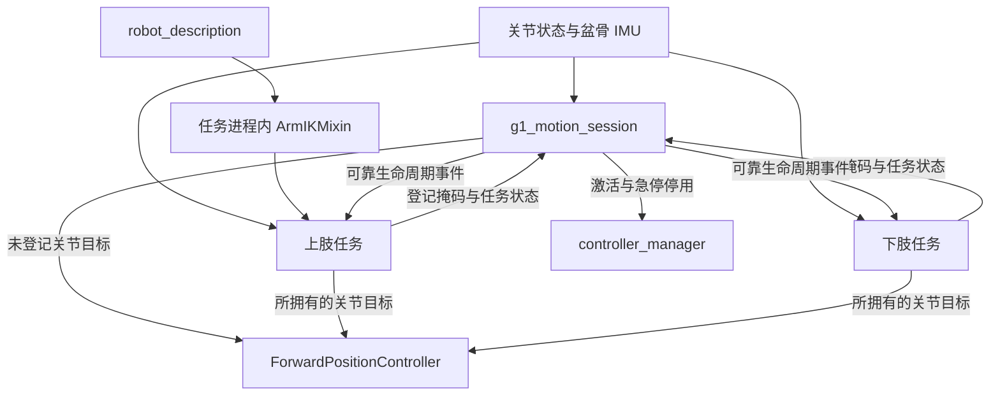

# G1 动作会话

## 上下肢划分

本包协调独立运行的上肢与下肢任务，按[硬件关节表](../unitree_g1_ros2_control/config/default_31dof_param.yaml)的 31 轴顺序登记所有权：下肢为 0–14 位的腿和腰，上肢为 15–30 位的双臂和夹爪。任务自行订阅反馈、计算目标并直接发布到 FPC，会话负责登记、生命周期事件、状态汇总和控制器启停。会话自身生成位置目标的例外是未登记关节的默认准备与保持（default/unowned prepare）；该输出只覆盖当前无人拥有的掩码。

### 上肢能力

| 任务包 | 能力 | 入口 |
|---|---|---|
| [upper_vr](../upper_vr/README.md) | 手柄双臂遥操作、夹爪控制与回位 | [vr_teleop.launch.py](../upper_vr/launch/vr_teleop.launch.py) |
| [upper_vla](../upper_vla/README.md) | VLA 推理、动作执行、观测历史和在线 RL | [vla_bridge.launch.py](../upper_vla/launch/vla_bridge.launch.py) |
| [upper_float](../upper_float/README.md) | 双臂实测位置跟随、夹爪保持 | [float.launch.py](../upper_float/launch/float.launch.py) |
| [upper_force_feedback](../upper_force_feedback/README.md) | 双臂实测位置互换力反馈，夹爪由会话保持 | [force_feedback.launch.py](../upper_force_feedback/launch/force_feedback.launch.py) |

会话内任务默认由 `TaskBase` 执行 `engage` 准备插值，准备终点发布后调用 `prepared(snapshot)`，不会调用 `start()`。`upper_vr`、`upper_vla`、`upper_float` 和 `upper_force_feedback` 在准备完成通知中开放上肢执行，与原先准备结束即可操作的行为一致；VLA 只播种 IK，推理仍需通过 `/vla_bridge/start` 显式启动。

录制回放在 [record](../record/README.md) 内复用 IK 工具，非会话任务。

### 下肢能力

| 任务包 | 能力 | 入口 |
|---|---|---|
| [lower_velocity_tracking](../lower_velocity_tracking/README.md) | 速度模型执行与速度指令跟踪 | [velocity_tracking.launch.py](../lower_velocity_tracking/launch/velocity_tracking.launch.py) |
| [lower_footstep_tracking](../lower_footstep_tracking/README.md) | 足步模型执行与落脚计划跟踪 | [footstep_tracking.launch.py](../lower_footstep_tracking/launch/footstep_tracking.launch.py) |

下肢任务将模型站姿作为基类准备目标，报告 `ready` 后等待会话 `start`，再重置并运行策略；准备结束到 start 之间由 FPC 保持终点。组合启动与正式键盘入口集中在 [robot_bringup](../robot_bringup/README.md)，默认键盘入口启动会话、下肢速度和上肢浮动；键盘控制业务由 [lower_velocity_tracking](../lower_velocity_tracking/README.md) 实现。[whole_vr.launch.py](../robot_bringup/launch/whole_vr.launch.py) 是 `robot_bringup` 对会话、`upper_vr` 和使用 VR 指令的 `lower_velocity_tracking` 的启动组合；[motion_tasks.launch.py](../robot_bringup/launch/motion_tasks.launch.py) 提供可选的上下肢组合，默认上肢仍为 VR。

## 架构



[TaskBase](g1_motion_session/task_base.py) 是会话内任务进程的 ROS 节点基类，提供登记客户端、事件订阅、任务状态发布、反馈订阅和掩码目标输出。控制周期数据不经会话转发。[ArmIKMixin](g1_motion_session/arm_ik_mixin.py) 在使用它的上肢进程内绑定机器人描述、求解与提交 IK，并共享[手臂 IK 配置](config/arm_ik.yaml)，不是远程 IK 服务。

### 原生 IK 内核

[ArmIK](g1_motion_session/arm_ik.py) 仅使用 C++ 高精度求解内核，不再提供 Python 后端或旧版单阶段 `standard` 求解分支。
[原生扩展](src/arm_ik_native.cpp) 编译为进程内 `_arm_ik_native.so`，每个求解器只创建一次
缩减 Pinocchio 模型与 Data，后续复用；没有每拍重新加载模型或进程间通信。
每次 `solve` 只跨一次 Python/C++ 边界，配置解析和关节向量拷贝只做一次；
GIL 用 RAII 管理，异常退出时也先恢复 GIL 再转换为 Python 异常。
Mixin 保留 `ik_backend` 参数和状态字段作为兼容性标识，值固定为 `cpp`；
旧配置指定 `python` 时启动明确报错，运行中修改为其他值也会拒绝。
扩展缺失会明确报错，不静默回退。更新动态库后必须安全停止并重启节点。

| 接口 | 数学求解 | 含关节限速窗口、救援种子及最终 FK 的控制管线 |
|---|---|---|
| 统一高精度接口 | `ArmIK.solve(seed, targets, *, joint_window=None)` | `ArmIK.step(seed, targets, dt)` |

返回形状均为 `(q, position_error_m, orientation_error_rad, iterations)`。
`ArmIK.solve` 首先用 SVD/Newton 和回溯线搜索求主任务；Newton 步无法降低加权误差时，
再尝试使用配置阻尼的 DLS 步。随后将偏好项投影到严格 SVD 零空间，沿非线性解流形迭代优化。
每次接受更新后重新计算雅可比与严格零空间基，沿投影梯度方向搜索（单步范数上限 `0.2 rad`），
每步最多 8 次缩步并检查非线性 FK，必要时进行主任务回投影，只接受总加权偏好代价严格下降
且位姿误差不超预算的调整。单个主任务候选、零空间外层迭代、整个零空间阶段的回投影总次数分别由
`ik_max_iters` 限制；返回的迭代计数包含被拒主任务候选和回投影的实际工作。
`ik_rotation_weight=0` 时只约束位置。

`ArmIK.step` 将 `seed ± rate_limit * dt` 窗口施加于**整个求解**，不再容许主任务越过该窗口后
依赖逐轴硬裁剪破坏末端轨迹。完整目标无法在窗口内满足容差时，从本拍起点沿 SE(3) 螺旋路径
同时缩小平移和旋转任务，最多尝试 8 个候选（1 到 1/128），每次都从相同起点求解并验证实际 FK。
返回误差始终相对于调用者的完整目标。成功的缩步不触发参考种子救援；没有可行候选时保持本拍起点
并明确报告受阻。位置/姿态残差在状态中保留 6 位小数。
`ArmIK.null_status` / Mixin 的 `ik_null_status` 报告最后一次求解的状态（`stationary` / `iteration_limit` / `blocked`）、
零空间迭代数、总偏好及肘部代价、零空间投影梯度、`task_fraction`（实际执行的任务比例，`0` 表示没有可行候选，`1` 表示完整目标）和是否发生最终限速。

## 构建与启动

在工作区根目录构建当前会话、任务与启动组合：

原生扩展需要 CMake 3.18+、Python 开发头文件和与 Python 模块一致的 Pinocchio C++ 库。
本机已验证两者均为 Pinocchio 4.0.0；不要混用另一套安装前缀的头文件/动态库。

```bash
source /opt/ros/humble/setup.bash
colcon build --packages-up-to g1_motion_session lower_velocity_tracking lower_footstep_tracking upper_vr upper_vla upper_float upper_force_feedback record robot_bringup --symlink-install
source install/setup.bash
```

以下命令在工作区根目录执行，每个终端先 `source scripts/env.sh`；已加载 Humble 与所需 SDK 环境时，也可 `source install/setup.bash`。设备侧由 [all_data.launch.py](../robot_bringup/launch/all_data.launch.py) 显式另起唯一控制器管理器：

```bash
source scripts/env.sh
ros2 launch robot_bringup all_data.launch.py scope:=whole_body topology:=dual
```

另一交互终端启动默认组合，一次启动一套会话、下肢速度任务、上肢浮动任务与键盘控制台：

```bash
source scripts/env.sh
ros2 run robot_bringup teleop_keyboard
```

正式键盘入口支持 `--upper-task {float,vr,vla,force_feedback}`、`--lower-config`、`--upper-config`，其余参数转交键盘节点作为 ROS 参数。入口不启动硬件、不自动 `engage` 或 `start`；退出先请求急停，再对自身启动的任务进程组发 SIGINT，既有硬件进程保持运行。

其他组合任选其一，均包含一套会话：

```bash
ros2 launch robot_bringup whole_vr.launch.py
ros2 launch robot_bringup motion_tasks.launch.py upper_task:=vla
ros2 launch robot_bringup motion_tasks.launch.py lower_task:=none upper_task:=float
ros2 launch robot_bringup motion_tasks.launch.py lower_task:=none upper_task:=force_feedback
```

已有会话与任务时，额外键盘终端使用 `ros2 run lower_velocity_tracking teleop_keyboard`，这是 control-only，只连接并控制既有任务，不重复启动会话、任务或硬件。独立部署是正式键盘入口或组合 launch 的另一种选择：[session.launch.py](launch/session.launch.py) 只启动协调节点，再用各任务包的 launch 启动所选上下肢。每套组合只包含一个会话，只选择一套方案，避免重复会话或任务登记。[dashboard.launch.py](launch/dashboard.launch.py) 可另起面板，不启动第二套会话。面板从 `status_topic`（默认 `/motion_control/status`）读取上肢任务的原始末端目标 `command_pose` 和 IK 提交关节指令正解 `limited_pose`，两者均为按 `left` / `right` 索引的 `[x, y, z, qx, qy, qz, qw]`；实测末端由页面模型计算，姿态权重写回当前任务的参数服务。

```bash
# 手动拆分部署时只启动一次会话
ros2 launch g1_motion_session session.launch.py

# 面板可连接已有会话
ros2 launch g1_motion_session dashboard.launch.py
```

反馈和任务登记就绪后接合；下肢及默认准备完成、`ready_to_start` 为真时再启动下肢策略。调用成功的 `engage` 仅表示已接受，控制器激活在后台继续完成；`start` 在尚未就绪时立即拒绝，不阻塞等待。

```bash
ros2 service call /motion_control/engage std_srvs/srv/Trigger '{}'
ros2 service call /motion_control/start std_srvs/srv/Trigger '{}'
```

使用 VLA 时，在上肢执行器就绪并满足该任务的服务端、任务和观测条件后，另行启动推理：

```bash
ros2 service call /vla_bridge/start std_srvs/srv/Trigger '{}'
```

## 生命周期

公共操作只提供四个命令，任务注册与状态接口独立保留：

| 命令 | 职责 |
|---|---|
| `engage` | 激活控制器并完成准备 |
| `start` | 准备就绪后启动等待执行的任务 |
| `stop` | 停止任务输出，FPC 仍激活并保持最后目标 |
| `estop` | 停止任务并请求停用 FPC |

每次 `engage` 广播递增的事件 epoch 和提前 50 ms 的共同 ROS 时钟起点。未运行任务从最新实测位置重新准备，已经 `RUNNING` 的任务忽略该事件并继续执行；未登记关节也重新进行默认准备。运行期间新登记的任务从 idle 开始，登记本身不触发动作，需要再次 `engage`。准备完成时调用任务的 `prepared(snapshot)`；上肢任务在该回调中开放执行，下肢等待显式会话 `start`。会话 `start` 要求控制器已激活、默认准备结束，且所有非运行任务均无错误并报告 ready。

`stop` 广播任务停止事件并停止会话默认目标发布，FPC 保持最后接收的目标，控制器仍激活；`estop` 先执行同样的停止广播，再请求停用控制器。会话安全检查默认开启：关节反馈或盆骨 IMU 超时、盆骨倾角超过 `tilt_limit_rad` 时拒绝 `engage/start`，活动期间触发 `estop`，不是仅暂停或保持目标。默认阈值 `1.0 rad` 约为 57.3°，不要求完全竖直；恢复后需人工重新接管。任务准备或启动抛出异常时由 `TaskBase` 转为本地 `ERROR` 并报告错误；生命周期定时器异常还调用本地停止处理，这不等于会话全局 `estop`。

```bash
ros2 service call /motion_control/stop std_srvs/srv/Trigger '{}'
ros2 service call /motion_control/estop std_srvs/srv/Trigger '{}'
```

VR 手柄回位、VLA 推理启停与业务复位由各任务自己处理，分别见 [upper_vr](../upper_vr/README.md) 和 [upper_vla](../upper_vla/README.md)。

## 登记与接口

- `/motion_control/register` 使用 [RegisterTask.srv](srv/RegisterTask.srv)：请求含 `task_id`、`mask`、`release`，响应含 `accepted`、`reason`。有效位为 0–30；任务名必须非空，掩码在有效位内必须非空，不同任务的所有权重叠会被拒绝。登记在默认发布共用锁内立即移除新拥有的位。
- `TaskBase` 启动后每 0.5 秒尝试登记；接受后停止重试，明确拒绝也停止重试并报告原因。退出销毁节点时，若已经登记、ROS context 有效且服务可用，则异步请求 `release=True`；这是尽力注销，不保证请求送达，异常退出也不会自动释放所有权。
- 显式注销会移除任务，将释放位交回默认输出，并以当前实测位置重置默认目标数组。下一次 `engage` 再从实测位置执行默认准备。
- `/motion_control/events` 使用 [MotionEvent.msg](msg/MotionEvent.msg)，QoS 为 RELIABLE、VOLATILE，字段为 `command`、`epoch`、`start_time`；命令为 `engage`、`start`、`stop`。`estop` 广播 `stop` 后请求停用控制器。晚加入任务不会收到历史事件。
- `/motion_control/tasks` 使用 RELIABLE 的 JSON `std_msgs/String`，包含 `task_id`、`mask`、小写 `state`、`epoch`、`ready`、`error` 及任务附加状态；准备状态为 `preparing`，准备完成等待启动为 `ready`。
- `/motion_control/status` 汇总会话状态 `idle/engaging/stand/running/estop`、`ready_to_start`、`execution_epoch`、反馈新鲜度、关节和任务摘要。执行 epoch 在首次成功激活或急停后的重新激活时更新，已激活控制器上的重复 `engage` 保持该值。
- 任务和会话默认输出直接发布 [JointTargets.msg](../unitree_g1_ros2_control/msg/JointTargets.msg)，各自只写拥有的掩码；底层接口见 [unitree_g1_ros2_control](../unitree_g1_ros2_control/README.md)。

## 配置

[session.yaml](config/session.yaml) 以 `/**` 提供准备和反馈安全参数。默认未登记下肢目标为站姿，上肢目标为被动姿态；默认准备先用 0.4 秒将肩 roll 向外清至至少左 +0.7、右 -0.7 rad，其余轴保持起始值，再在剩余 2.1 秒移到默认目标。只发布未登记位，全被登记时无需会话默认准备。

`safety_checks_enabled` 默认 `true`，启动时读取并禁止运行时修改。关闭后 session 不订阅 IMU，不做会话级传感器超时/倾角拦截或自动急停；任务自身的数据检查、准备就绪判断与底层硬件反馈保护不变。可在 YAML 中设置，或使用启动覆盖；覆盖留空时采用 YAML：

```bash
ros2 launch robot_bringup motion_tasks.launch.py lower_task:=none upper_task:=force_feedback safety_checks_enabled:=false
```

`session.launch.py`、`whole_vr.launch.py` 和 `record_all.launch.py` 同样支持此覆盖。键盘组合默认读取 YAML，改变配置后在安全停机窗口重启运动组合；不要通过另起一套 session 来切换。倾角检查不保证能在失去平衡前阻止跌倒，仍需现场支撑和人工急停。

各 launch 直接声明 ROS 参数文件列表：任务自己选择公共准备参数、自身默认配置与用户覆盖，VR、VLA、插孔等使用 IK 的任务加载共享手臂参数；session launch 只选择自身配置。统一关节表最后加载，命令行专属覆盖随后应用。覆盖文件可用调用方包内相对路径或绝对路径。[CMakeLists.txt](CMakeLists.txt) 安装 Python 实现、生成的 ROS 接口、配置、launch 和可执行入口。

## 验证

[登记与生命周期单测](test/test_registry.py) 覆盖掩码冲突、默认输出交接、重复接合、就绪门控、任务异常、停止与急停和配置覆盖。[真实 ROS 生命周期测试](test/test_ros_lifecycle.py) 验证独立节点通信；[VLA ROS 初始化测试](../upper_vla/test/test_ros_initialization.py) 验证真实 VLA 节点登记、机器人描述绑定与无推理准备。

构建并加载当前工作区后，在隔离 ROS 域执行已有测试：

```bash
source /opt/ros/humble/setup.bash
source install/setup.bash
ROS_DOMAIN_ID=217 python3 -m pytest src/g1_motion_session/test/test_registry.py src/g1_motion_session/test/test_ros_lifecycle.py src/upper_vla/test/test_ros_initialization.py -q
```
