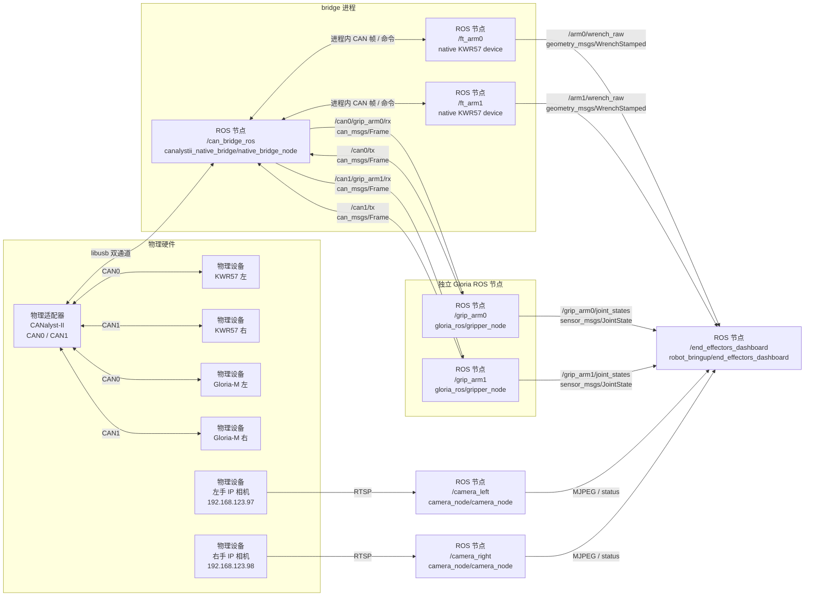
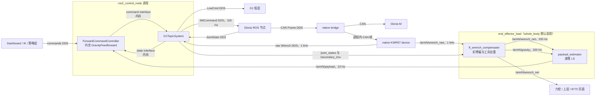

# `robot_bringup`
`robot_bringup` 组合本仓库已有节点，并提供正式安装的运动键盘启动入口，不实现 CAN 协议、视频处理或控制器。上下肢组合启动与键盘入口集中在本包，任务与键盘控制业务由各功能包实现。末端设备实现在 `robot_bringup/end_effectors/`；`unitree_g1_description` 提供模型资源，`unitree_g1_ros2_control` 提供真实的 ros2_control `SystemInterface`、C++ controller 与 broadcaster。

## 全部入口
以下命令在工作区根目录执行，每个终端先 `source scripts/env.sh`；已加载 Humble 与所需 SDK 环境时也可 `source install/setup.bash`。运动组合只启动任务与一个 session，不启动硬件、不自动接管；硬件与控制栈由 `all_data.launch.py` 显式另起，Dashboard 另起。每次只选择一套包含 session 的运动方案。

| 命令 | 实际启动 |
|---|---|
| `ros2 launch robot_bringup all_data.launch.py scope:=whole_body topology:=dual` | **推荐整机入口**（同时也是全部默认值）：末端拓扑 + 唯一真实 `controller_manager` + 统一硬件插件 + broadcaster + URDF + inactive FPC + 末端负载链 |
| `ros2 run robot_bringup teleop_keyboard` | **默认键盘入口**：一套 session + 下肢速度 + 上肢浮动 + 当前交互终端键盘控制台，硬件另起 |
| `ros2 run robot_bringup teleop_keyboard --upper-task vr` | 下肢键盘速度 + 上肢 VR + session + 键盘控制台 |
| `ros2 run robot_bringup teleop_keyboard --upper-task vla` | 下肢键盘速度 + 上肢 VLA + session + 键盘控制台，VLA 推理仍需手动 start |
| `ros2 launch robot_bringup motion_tasks.launch.py upper_task:=vla` | session + 下肢速度 + 上肢 VLA，VLA 推理仍需手动 start |
| `ros2 run lower_velocity_tracking teleop_keyboard` | control-only：只连接现有 session 与任务，不启动任务或硬件 |
| `ros2 launch robot_bringup motion_tasks.launch.py` | session + 下肢速度策略 + 上肢 VR，各任务直接发布 FPC 关节目标 |
| `ros2 launch robot_bringup whole_vr.launch.py` | session + 上肢 VR + 摇杆速度跟踪，不重复启动硬件 |
| `ros2 launch robot_bringup motion_tasks.launch.py lower_task:=none upper_task:=float` | session + 独立上肢浮动，腰腿保持默认目标 |
| `ros2 launch robot_bringup motion_tasks.launch.py lower_task:=none upper_task:=force_feedback` | session + 双臂位置互换力反馈，腰腿和夹爪保持默认目标 |
| `ros2 launch robot_bringup motion_tasks.launch.py lower_task:=footstep upper_task:=vla` | session + 脚步策略 + `upper_vla`；VLA 保持 `/vla_bridge` 服务 |
| `ros2 launch record record.launch.py` | 录制 + 数据管理与内置回放，回放前已有 FPC 必须 active |
| `ros2 run record data_manager` | 只启动数据页面与内置回放，无需额外执行器入口 |
| `ros2 launch robot_bringup record_all.launch.py` | 硬件、传感器、运动任务、定位、录制和数据管理与内置回放，统一退出 |
| `ros2 launch robot_bringup all_data.launch.py scope:=end_effectors topology:=dual` | 只启末端拓扑：bridge、进程内 KWR57、Gloria-M、左右相机 |
| `ros2 launch robot_bringup all_data.launch.py scope:=whole_body end_effector_load:=false` | 整机但不启净力/负载估计，重力补偿退回标称工具重量 |
| `ros2 launch robot_bringup all_data.launch.py enable_grippers_on_start:=false` | 同上，但两只 Gloria-M 上电保持失能 |
| `ros2 launch robot_bringup end_effectors_single_bus.launch.py` | `all_data topology:=single` 使用的底层单通道末端拓扑 |
| `ros2 launch robot_bringup end_effectors_dual_bus.launch.py` | `all_data topology:=dual` 使用的底层双通道末端拓扑 |
| `ros2 launch robot_bringup end_effector_load.launch.py` | KWR57 净力补偿 + 末端负载估计；`scope:=whole_body` 已默认 include |
| `ros2 launch robot_bringup end_effectors_dashboard.launch.py topology:=dual` | 末端联调网页 `8770`；不启动任何数据节点 |
| `ros2 run robot_bringup end_effectors_dashboard` | 同上，不经过 launch，全用默认参数 |
| `ros2 launch robot_bringup whole_body_dashboard.launch.py` | controller 测试网页 `8200`；连接已有 manager |
| `ros2 launch robot_bringup lowlevel_dashboard.launch.py` | `LowState` 只读监控页 `8210`；不依赖本仓库任何东西 |
| `ros2 launch robot_bringup lowlevel_dashboard.launch.py lowstate_topic:=/lowstate secondary_imu_topic:=/secondary_imu` | 同上，改订 1040 Hz 高频流，代价接近一个核 |
| `ros2 param set /forward_position_controller compensation_scale 0.0` | 临时关掉手臂重力补偿 |
| `ros2 run robot_bringup enter_debug_mode` | 释放运控模式、交出 `/lowcmd`；走 ros2_control 时不需要 |
| `ros2 run robot_bringup exit_debug_mode` | 卸力斜坡 + 交还 `ai` 模式；控制栈被强杀后的兜底 |
| `kill -INT -- -"$(ps -o pgid= -p "$(pgrep -f 'ros2 launch robot_bringup all_data' \| head -1)" \| tr -d ' ')"` | 正确停控制栈（**发给进程组**）；**绝不要 `pkill`**，原因见下文 |

网页端口：`8770` 末端联调、`8200` 整机 controller、`8210` 底层只读、`8010`/`8011` 相机自带页。**本机访问用 `127.0.0.1` 而不是 `localhost`**：节点只绑 IPv4 `0.0.0.0`，`localhost` 常先解析到 IPv6 `::1`，表现为页面能开、数据不来。远程转发 `ssh -L 8770:127.0.0.1:8770 user@robot`，其余端口同理。

## 运动与采集

会话内上肢任务为 `upper_vr`、`upper_vla`、`upper_float`、[upper_force_feedback](../upper_force_feedback/README.md)，下肢任务为 `lower_velocity_tracking` 或 `lower_footstep_tracking`。各任务认领关节并直接向 FPC 发布掩码目标，`g1_motion_session` 协调注册与生命周期。`lower_task` 可选 `velocity/footstep/none`，`upper_task` 可选 `vr/vla/float/force_feedback/none`。直接调用 `motion_tasks.launch.py` 默认为下肢 velocity、上肢 VR；正式键盘入口默认为下肢 velocity、上肢 float，两者是不同的默认组合。

[record](../record/README.md) 的 DataManager 在自身进程内创建 ReplayTask，两个节点共用 executor。回放读取 `motion_control_command` 末端轨迹，从当前实测姿态缓入首动作，通过共享本地 IK 输出上肢槽位 15..30 的 `JointTargets`。`record.launch.py` 默认 `data:=true` 自动带数据管理与回放；`data:=false` 只启动 recorder。只需数据页面与回放时执行 `ros2 run record data_manager`。回放复用 g1_motion_session 的 IK 工具，非会话任务。

**数据页面的“回放”执行真实动作，FPC 必须提前 active。** 注意停下其他目标源：回放不检查竞争或强制排除发布者，同一槽位按 FPC 最后收到的目标执行，session 的准备操作也可能发布目标。默认请求、状态与停止接口为 `/replay/request`、`/replay/status`、`/replay/stop`；停止回放后 FPC 保持最后目标。可选绝对 YAML 参数 `replay_config` 用于覆盖共享 IK，namespace 不改变默认绝对端点。完整接口与配置见 [record 使用说明](../record/README.md)。

默认交互入口如下，硬件在另一终端用 `all_data.launch.py` 显式启动或复用既有栈：

```bash
source scripts/env.sh
ros2 run robot_bringup teleop_keyboard
```

正式键盘入口由 [motion_keyboard.py](robot_bringup/motion_keyboard.py) 的 `main` 实现，以 `teleop_keyboard=robot_bringup.motion_keyboard:main` 安装。它支持 `--upper-task {float,vr,vla,force_feedback}`、`--lower-config`、`--upper-config`，未知参数交给键盘节点作为 ROS 参数，任务参数与默认配置保持不变：

```bash
ros2 run robot_bringup teleop_keyboard --upper-task vr
ros2 run robot_bringup teleop_keyboard --upper-task force_feedback
ros2 run robot_bringup teleop_keyboard --lower-config /workspace/src/lower_velocity_tracking/config/lower_body.yaml --upper-config /workspace/src/upper_float/config/upper_float.yaml
ros2 run robot_bringup teleop_keyboard --ros-args -p vx_step:=0.05
```

键盘入口启动任务，不自动 `engage` 或 `start`；上肢 VLA 推理仍通过 `ros2 run upper_vla vla_cli` 手动 `/start`。退出时控制台先请求 `/motion_control/estop`，再向本入口创建的任务进程组发送 SIGINT，让任务与 session 收尾，不停止既有硬件进程。任务 launch 日志写入启动时显示的临时文件。

不需要组合键盘时，直接选择以下一套 launch；每套只包含一个 session，以 Ctrl+C 退出自身组合，硬件继续由独立终端管理：

```bash
# 上肢 VR 与 VR 摇杆下肢速度输入，lower_source 为 vr
ros2 launch robot_bringup whole_vr.launch.py

# 下肢速度与上肢 VLA，推理另行显式 start
ros2 launch robot_bringup motion_tasks.launch.py upper_task:=vla

# 独立上肢浮动，腰腿由 session 默认目标管理
ros2 launch robot_bringup motion_tasks.launch.py lower_task:=none upper_task:=float
```

`whole_vr.launch.py` 使用下肢 `lower_vr.yaml`，将 `lower_source` 设为 `vr`；其余组合使用所选任务的默认配置。launch 配置覆盖使用 `lower_config:=... upper_config:=...`。

会话安全检查默认开启。`motion_tasks.launch.py`、`whole_vr.launch.py` 和 `record_all.launch.py` 可用 `safety_checks_enabled:=false` 在启动时关闭会话级倾角/传感器超时检查，任务与硬件保护不变；省略参数则取 session YAML。阈值、触发行为与重启要求见 [g1_motion_session](../g1_motion_session/README.md#配置)。

正式键盘入口、组合 launch 和手动拆分部署是互斥的启动方案，不重复启动 session 或同一任务。已有组合需要额外键盘终端时，执行 `ros2 run lower_velocity_tracking teleop_keyboard`，这是 control-only 入口，只连接已有 session 与任务，不重复启动它们或硬件；其速度由选择 keyboard 来源的下肢任务消费。上肢监控使用 `ros2 launch g1_motion_session dashboard.launch.py`，只连接已有会话。

`record_all.launch.py` 是 [采集全链入口](launch/record_all.launch.py)：硬件与头部传感器在 0 s 启动，运动任务在 6 s、定位在 8 s、录制在 12 s 启动。默认录制头部图像为 `1280x720x30 / YUYV`，腕相机由 recorder 复制原码流；完整参数和数据格式见 [record 使用说明](../record/README.md)。`upper_vla` 依赖 record 的工具，全链编排保持在 bringup。

```bash
ros2 launch robot_bringup record_all.launch.py
ros2 launch robot_bringup record_all.launch.py hardware:=false motion:=false
ros2 launch robot_bringup record_all.launch.py lower_task:=footstep upper_task:=vr
ros2 launch robot_bringup record_all.launch.py data:=false
```

各阶段开关为 `hardware/sensors/motion/localization/record`，参数如 `output_root:=/data/sessions`、`round_items:=5` 继续传给子 launch。硬件已运行时只补缺失阶段，避免重复 controller manager 或设备节点；已有运动组合或 session 时设 `motion:=false`，不再叠加第二套运动会话。采集入口需要键盘时使用上述 control-only 命令。

同一个 launch 的 Ctrl-C 会让硬件完成卸力斜坡，并让 recorder 等 ffmpeg 冲完缓冲、计算校验并写入 `DONE`。采集入口保留 `sigterm_timeout:=40` 和 `sigkill_timeout:=10`。脚本停机必须将 SIGINT 发给整个前台进程组；只向 launch PID 发 SIGINT 可能留下节点。后台启动先使用 `set -m`，避免子 shell 将 SIGINT 设为忽略。不要用 SIGTERM 或 SIGKILL 替代正常收尾。

## 末端设备结构
`all_data.launch.py scope:=end_effectors topology:=dual` 的实际数据流如下；8770 Dashboard 是独立进程，用户需要时再手动启动：



图中每个写有“ROS 节点”的方框都是一个实际 ROS 2 node。`/can_bridge_ros`、`/ft_arm0`、`/ft_arm1` 是同一原生 C++ bridge 进程中的三个节点，两个 KWR57 节点直接吃进程内 CAN 帧并完成严格三帧组包；`/grip_arm0`、`/grip_arm1` 是独立 Gloria 节点，bridge 把命中的帧改发到各自专属 RX 话题，解码后再发 `JointState`。`can_bridge_ros` 与 `kwr57_ros` 只作为独立调试入口保留，不在上图生产路径里。

启动前会检查总线、节点名、Wrench 话题以及同通道 CAN ID 冲突。

`scope:=whole_body` 在上述设备路径旁增加唯一 `ros2_control_node`，不会在 controller 与硬件插件之间增加 DDS：



LowCmd 编码在 C++ 硬件插件内完成，Gloria 协议在独立 `gloria_ros` 节点，KWR57 三帧协议在 bridge 进程内。这样保留各设备独立 launch 和诊断能力，同时避免 controller-manager facade、状态重发节点和 KWR57 中间 CAN Frame 流。

## 末端设备清单
`end_effectors_single_bus.launch.py` 描述 CAN0 上的最终四设备拓扑：

| 设备 | 命令 ID | 数据/反馈 ID | 输出或 RX |
|---|---:|---|---|
| `ft_left` | `0x10` | `0x15/0x16/0x17` | `/ft_left/wrench_raw` |
| `ft_right` | `0x11` | `0x18/0x19/0x1A` | `/ft_right/wrench_raw` |
| `grip_left` | `0x01` | `0x101/0x01/0x000` | `/can0/grip_left/rx` |
| `grip_right` | `0x02` | `0x102/0x02/0x000` | `/can0/grip_right/rx` |

网络相机不占用 CAN，总线接线模式变化时仍启动同一组相机：

| 设备 | IP | Web 端口 | ROS 图像话题 |
|---|---|---:|---|
| `camera_left` | `192.168.123.97` | `8010` | `/camera_left/image_raw` |
| `camera_right` | `192.168.123.98` | `8011` | `/camera_right/image_raw` |

两台相机均使用 `rtsp://admin:123456@<IP>/stream1` 子码流（640x360，限 15 fps），接口和排障见 [`camera_node/README.zh.md`](../camera_node/README.zh.md)。

`end_effectors_dual_bus.launch.py` 每条总线一台 KWR57 和一台 Gloria-M；不同物理通道可以复用相同 CAN ID。这也是当前联调台架的接线。

KWR57 一律以 **SI 发布**（`use_si=True`）：`geometry_msgs/Wrench` 就定义在 N 与 N·m，发出厂默认的 kgf 等于把一个 9.8 倍的陷阱留给每一个下游。

总线占用实测见 [`CAN_BUS_LOAD.md`](CAN_BUS_LOAD.md)。2026-07-23 的 30 秒生产验收（双 KWR57 + 双 Gloria-M + active FPC，无相机并发）左右 ROS receive 最大 gap `7.027/7.433 ms`、CAN TX `99.999/100.001 Hz`，四设备正常负载目标通过；边界与空 USB 包根因见 [`canalystii_native_bridge/README.md`](../canalystii_native_bridge/README.md)。

生产拓扑固定用 KWR57 进程内 handler。ROS Frame 回退只留在单设备调试入口 `kwr57_ros/ft_sensor_debug.launch.py use_frame_handler:=false` 和外部 bridge 入口 `kwr57_ros/ft_sensor.launch.py`，原因与 PC2 性能数据见 [`kwr57_ros/README.md`](../kwr57_ros/README.md)。

## 数据启动
```bash
source scripts/env.sh
# 推荐整机入口：设备 + 唯一 manager + inactive FPC
ros2 launch robot_bringup all_data.launch.py scope:=whole_body topology:=dual

# 仅设备和原始话题，不启 ros2_control
ros2 launch robot_bringup all_data.launch.py scope:=end_effectors topology:=dual
```

两个 scope 都启动末端设备；`whole_body` 额外 include `unitree_g1_ros2_control/control.launch.py`，启动唯一真实 `controller_manager`、500 Hz 硬件循环、100 Hz JointState/IMU broadcaster、一份展开 URDF 和一个 TF 发布器。夹爪状态显式命名为 `left_eccentric_joint`、`right_eccentric_joint`。两种 scope 都不启 Dashboard。

相机节点同时提供 ROS Image 和 8010/8011 内置页，但两条路都是**按需拉流**，没人订阅就不连相机；主机必须具备到 `192.168.123.0/24` 的路由。

生产拓扑默认启动后自动配置并使能两只 Gloria-M（`enable_grippers_on_start:=false` 关掉）；这不改变 `gloria_ros` 独立调试入口默认失能的安全行为，也不改变 controller 默认保持 `inactive`。

**不要在同一 ROS graph 重复启动 `control.launch.py`**（`scope:=whole_body` 已 include），也不要同时跑任何会独占 CANalyst-II 的 `*_debug.launch.py`。

### 末端负载（净力 + 自适应重力补偿）
`scope:=whole_body` 默认拉起这条链，链路见上方架构图里的 `end_effector_load` 子图，两个节点各自做什么见 [`arm_gravity_compensation/README.md`](../arm_gravity_compensation/README.md)。

```bash
# 默认已含；传感器拔了、或标定过期想回到标称工具重量时才关掉
ros2 launch robot_bringup all_data.launch.py scope:=whole_body end_effector_load:=false
# 已有整机栈时单独补上
ros2 launch robot_bringup end_effector_load.launch.py
```

**只在 `whole_body` 下有意义**：补偿节点要关节角和躯干 IMU。它依赖仓库里已导出的 `ft_calibration.yaml`；该文件缺失或不合法时只有这两个节点退出，整机栈照常跑，重力补偿在 `payload_timeout_s` 后退回标称工具重量。起来后 8770 页面会自动多画一组净力六轴条。

**启动负载节点不等于开始估计**：`payload_estimator.estimation_enabled` 默认 `false`，两侧持续输出零负载；净力 `wrench_net` 和手臂自身重力补偿照常工作。只有显式开启后才实时估计，浮动手拉与传感器未校准时保持关闭。

```bash
ros2 param get /payload_estimator estimation_enabled
ros2 param set /payload_estimator estimation_enabled true   # 开启实时估计
ros2 param set /payload_estimator estimation_enabled false  # 禁止估计并清空历史
```

关闭会清空估计并持续发布零负载，控制器平滑淡出额外补偿；重启默认关闭。不能用 `compensation_scale=0` 代替，那会连手臂自重补偿一起关闭。

## 双手 Web 联调
先启数据再启网页，`topology` 必须一致：
```bash
source scripts/env.sh
ros2 launch robot_bringup end_effectors_dashboard.launch.py topology:=dual

# 或者不经过 launch，全用默认参数
ros2 run robot_bringup end_effectors_dashboard
```

浏览器打开 `http://<机器人 IP>:8770`：页面固定为 CAN0 左手、CAN1 右手两栏，每栏同时显示手部相机画面、KWR57 六轴、Gloria-M 位置/速度/力矩以及在线状态。

8770 始终创建 `/grip_*/mit_command` publisher 和夹爪生命周期服务客户端，开放 enable/disable、单次 MIT 目标和往返（反馈位置进入目标 ±0.10 rad 或最长 3 秒后换向，开始前调 `enable`、停止时调 `disable`）。这条路径绕过 controller manager 的 resource claim，**必须配 `scope:=end_effectors`，不能与整机 ros2_control 同时作为命令源**。消息和安全参数见 [`gloria_ros/README.md`](../gloria_ros/README.md)。

Dashboard 以 BEST_EFFORT、`KEEP_LAST(64)` raw 订阅两路 `WrenchStamped`，高频回调只存最新序列化样本并计数，HTTP 快照时才反序列化。页面显示 3 秒平均接收频率，实测左右均约 1 kHz；该平均值不代表每个样本都满足 1 ms deadline。

网页节点通过同源 URL `/api/cameras/<left|right>/video_feed` 代理相机 MJPEG，因此远程只需转发 `8770`。后台独立探测相机 `/status`；某台相机断流时只有对应栏显示离线占位，KWR57、夹爪及另一台相机不受影响。没人看页面时 `/status` 报 `idle` 但仍算在线；页面一打开流就自己起来，断流后每秒自动重连。

代理用两个不同的超时：`camera_timeout_s`（默认 1.0）只管 `/status` 轮询，MJPEG 流用 `camera_stream_timeout_s`（默认 10.0）。相机是按需拉流，从代理接上到第一帧要经过 1 Hz 监管轮询 + RTSP 握手，冷启动 1~3 秒，**拿 1 秒去等首帧会每次都在首帧前超时断开**，表现为相机日志里「开始拉流」后恰好 2 秒就「没人要图，停止拉流」，页面永远白着。

单独跑网页节点时默认仍连本机 `8010/8011`；相机服务在其他主机或端口时设置 `left_camera_url`、`right_camera_url`，`end_effectors_dashboard.launch.py` 还暴露 `camera_timeout_s`、`camera_stream_timeout_s` 和 `camera_poll_period_s`。双总线四设备接线下两栏都应在线；单侧离线时按页面显示的总线和设备节点查对应通道。

## 底层数据监控页
把 `LowState` 的每一个字段铺出来，包括 `g1_motion_session` 上肢监控页之外的力矩、电压、`sensor` 和 `mode`：
```bash
source scripts/env.sh
ros2 launch robot_bringup lowlevel_dashboard.launch.py
```

浏览器打开 `http://<机器人 IP>:8210`。**本机访问用 `127.0.0.1` 而不是 `localhost`**：节点只绑 IPv4 `0.0.0.0`，而 `localhost` 常先解析到 IPv6 `::1`，表现为页面能打开、数据却一直不来。

这个页面**不依赖本工作区的任何东西**：它直接订阅 G1 固件发的话题，不需要 `all_data`、`/controller_manager`、`/robot_description` 或 TF。控制栈没起来也能看，正好用来判断"是机器人没数据还是我们的栈有问题"。

| 页面区域 | 内容 |
|---|---|
| 左上表格 | 35 个电机槽（29 本体 + 6 宇树预留，预留默认折叠），每行 `mode`、`q`、`dq`、`ddq`、`tau_est`、外壳/绕组温度、`vol`、`motorstate`、`sensor` |
| 左下 IMU | 盆骨（`LowState.imu_state`）与躯干（`/lf/secondary_imu`）对照。四元数按固件的 **`w x y z`** 原样显示，不是 ROS 的 `xyzw` |
| 右侧曲线 | 勾表格**列头**决定画哪些信号，勾表格**行**决定画哪些电机；每列一张图、各自的量纲与 Y 轴。单张窄于 600 px 就自动折行并把图均分到各行 |
| 顶部 | `mode_pr`、`mode_machine`、`tick`、实测总线频率 |

`wireless_remote`（40 字节遥控器原始数据）和 `crc`、`version` 折叠在 IMU 下方。

**纯只读**：不发布任何话题、不调用任何服务，`ros2 node info /lowlevel_dashboard` 的 Publishers 只有 `/rosout` 和 `/parameter_events`。没人看页面时会退订，页面重开自动订回。

默认订阅固件的 `/lf/*` 低频版。`/lf/lowstate` 与 `/lowstate`、`/lf/secondary_imu` 与 `/secondary_imu` 都由 G1 固件直发（ROS 图里显示为 `_CREATED_BY_BARE_DDS_APP_`，因为它用裸 CycloneDDS 而不是 rclcpp），内容逐字段相同，只差频率：

| 话题 | 实测频率 | 何时用 |
|---|---|---|
| `/lf/lowstate` + `/lf/secondary_imu`（默认） | 20 Hz | 日常监控，够用 |
| `/lowstate` + `/secondary_imu` | 1040 Hz | 看高频细节时换过去，代价是接近一个核 |

```bash
ros2 launch robot_bringup lowlevel_dashboard.launch.py \
  lowstate_topic:=/lowstate secondary_imu_topic:=/secondary_imu
```

两路都用 `raw=True` 订阅，回调只存字节串，反序列化（实测 712 µs，占整条链路 79%）推迟到浏览器真的来问的那一刻——所以开销跟的是页面轮询频率，不是总线频率。不这么做时 spin 线程握着 GIL 不放，HTTP 单次响应会被饿到 200 ms。页面固定 20 Hz 轮询，和总线对齐，再快只会拿到重复帧。

## 整机 ros2_control 与测试面板
先启动全部硬件与真实控制栈，再单独启动测试网页：
```bash
source scripts/env.sh
ros2 launch robot_bringup all_data.launch.py scope:=whole_body topology:=dual
ros2 launch robot_bringup whole_body_dashboard.launch.py
```

第一条启动唯一 `/controller_manager`，将 `/lowstate`、双 Gloria-M、双 KWR57 和 pelvis IMU 接入 `hardware_interface`，发布 `/robot_description`、TF 与统一 `/joint_states`；第二条只在 `http://<机器人 IP>:8200` 提供网页。FPC 已加载但保持 `inactive`，激活后 claim 29 个 G1 关节和两只 Gloria。夹爪采用独立、更宽的 `0.75 s` feedback timeout，单侧 stale 只停该侧，不切断本体 LowCmd。

Dashboard wrapper 只把切换超时放宽到 30 秒并做切换后状态校验，不代理任何 controller-manager 服务。Web 快照还会按 URDF joint limit 一次性重算 Gloria-M 的受限分段 mimic FK，并隐藏 `internal_*` 虚拟 link/joint，不改变 `/joint_states`、TF 或控制链。Engage/Disengage 的 MotionSwitcher、夹爪生命周期、状态 freshness 和回滚由 C++ 硬件插件执行，详见 [`unitree_g1_ros2_control/README.md`](../unitree_g1_ros2_control/README.md)。实机 Disengage 后仍建议独立确认 controller 为 `inactive`、命令接口为 `unclaimed`、两只夹爪已失能且 MotionSwitcher 模式已恢复。

手臂重力补偿已内置在 FPC 里，不是另一个 controller，页面上只看得到 FPC 一项：

```bash
# 临时不要补偿
ros2 param set /forward_position_controller compensation_scale 0.0
```

`robot_test_dashboard` 是通用测试客户端，对 FPC 生成限速后的 `Float64MultiArray`。双臂 IK 由独立上肢任务调用公共 IK 工具，`g1_motion_session` 统筹生命周期并提供上肢监控页；键盘业务由 `lower_velocity_tracking` 实现，监控页的姿态权重写入当前上肢任务的参数服务。

Gloria-M 使用 `kp=10`、`kd=5`。`kd=5` 是 SDK `pack_mit_command()` 将 12 bit 字段映射到 `[0,5]` 后的最大值；输入 10 会在 SDK 层被夹到 5，因此统一节点启动时拒绝超出该范围的配置。

默认模型根帧为 `pelvis`，TCP 为 `right_gripper_base`。没有真实 ros2_control 栈时，页面会等待 `/robot_description`、`/joint_states`、TF 和 `/controller_manager`。

### 手臂浮动
已有整机硬件栈时，启动唯一 session 与上肢浮动任务，另一终端显式接管：
```bash
source scripts/env.sh
ros2 launch robot_bringup motion_tasks.launch.py lower_task:=none upper_task:=float
```
```bash
ros2 service call /motion_control/engage std_srvs/srv/Trigger '{}'
```

准备完成后，`upper_float` 将14个手臂关节的实测角持续交给 FPC，由现有重力补偿与阻尼承担浮动控制；腰腿进入 session 默认站姿并保持，夹爪保持最后目标。完整接口见 [upper_float](../upper_float/README.md)。

**不要让手臂长时间停在水平位附近。** 保持姿态需要持续电流，曾实测肩部绕组到 97 °C。用完请求 `/motion_control/estop` 停用 FPC；需要关闭整机栈时，在硬件终端 Ctrl+C，等待硬件卸力并交还 `ai`。仅停止目标发布不等于卸力。

### 进入调试模式
用 ros2_control 时不需要这一步：`G1TopicSystem` 在 Engage 时自己走 MotionSwitcher `CheckMode`(1001) → `ReleaseMode`(1003)。**只有绕开 controller、自己发 `/lowcmd` 时才需要显式切换**。

待机的 `ai` **自己就在以 1 kHz 发 `/lowcmd`**，内容全零（`mode=1`，`q`/`dq`/`tau`/`kp`/`kd` 都是 0）——使能但不出力。这些零帧不把关节拉向别的目标，所以运控没释放时外部 `/lowcmd` **看起来能动**，实际是两条流交替、命令被稀释。释放后 `/lowcmd` 掉到 **0 Hz**，那才是独占。

```bash
source scripts/env.sh
ros2 run robot_bringup enter_debug_mode
```

它只释放运控模式，**不发任何 `/lowcmd`**：切换后机器人处于无人接管状态，谁开始发 `/lowcmd` 谁接管，且必须自己把增益从零升上来（运控模式不做交接）。日志会打印 `mode_machine`，写 `LowCmd` 时必须原样填回去，并且每帧都要算 CRC——直接用 `arm_gravity_compensation.lowcmd` 的 `populate_arm_command()`，它同时处理 `mode`/`mode_pr`/CRC。

| 参数 | 默认 | 说明 |
|---|---|---|
| `--allow-from` | `ai` | 允许从哪些模式释放；空模式名恒定允许 |
| `--force` | — | 释放任意模式，**正在撑着机器人的模式会直接瘫倒** |
| `--call-timeout` | 3.0 | 单次 MotionSwitcher 应答超时 |
| `--release-timeout` | 10.0 | 等待模式清空的总时长 |

唯一的拦截是 `--allow-from`，用来避免"从站立模式释放导致瘫倒"。遥控器上 `L2+B` 可以先切到阻尼再挂起机器人，模式表见 [G1.md](../../G1.md)。

**这里不检查 `/lowcmd` 是否静默。** 这个工具一帧都不发，抢不了总线；而释放前总线上那 1 kHz 本来就是 `ai` 自己的，查了必然误报。防双 publisher 是接管程序的责任，且只有在释放**之后**查才有意义。

### 退出调试模式
正常用 `Ctrl-C` 关闭 `all_data.launch.py scope:=whole_body` 时，`G1TopicSystem::stop()` 会自动花 2s 把关节增益降到零，再把机器人交还给 `ai`（零力矩）模式，**不需要额外命令**。

> **不要用 `pkill` 停控制栈。** 各节点的清理逻辑都挂在 SIGINT 上，`pkill` 默认发 SIGTERM，rclpy 不处理它，rclcpp 也来不及跑完关闭序列。本仓库已经因此踩过三次坑：
>
> | 被跳过的清理 | 后果 |
> |---|---|
> | `G1TopicSystem::stop()` 的卸力斜坡 | 关节保持最后一帧命令持续吃电流，肩部绕组升到 97 °C |
> | `gloria_ros` 的 `disable_on_shutdown` | 两只 Gloria-M 一直留在使能态 |
> | `native_bridge_node` 的 USB 传输取消 | CANalyst-II 固件卡死，之后每次启动都报 `LIBUSB_ERROR_TIMEOUT`，**只能物理拔插复位** |
>
> 必须用信号时也要发 SIGINT，且发给**整个进程组**：
>
> ```bash
> LP=$(pgrep -f 'ros2 launch robot_bringup all_data' | head -1)
> kill -INT -- -"$(ps -o pgid= -p "$LP" | tr -d ' ')"
> ```
>
> 2026-08-26 更正：之前写的「只发给 launch 进程，由它转发」是错的。**`ros2 launch` 在关闭路径上从不主动发 SIGINT**（见 `launch/actions/execute_local.py` 的 `__get_shutdown_timer_actions`，它只挂 SIGTERM / SIGKILL 两级升级定时器）。Ctrl-C 能用是因为内核把 SIGINT 送给前台进程组的每一个成员。只发给 launch 进程等于绕开了这套清理。

控制栈被强杀、崩溃或从未启动时该路径不会执行，关节会保持最后一帧命令持续吃电流。用这个工具兜底：
```bash
source scripts/env.sh
ros2 run robot_bringup exit_debug_mode
```

它不走 ros2_control，直连 `/lowcmd` 与 MotionSwitcher，所以控制栈是否存在都能用。

| 参数 | 默认 | 说明 |
|---|---|---|
| `--ramp-s` | 2.0 | 力矩淡出时长 |
| `--damping` | 1.5 | 下降全程保持的 `kd`，调大可以降得更慢 |
| `--motion-mode` | `ai` | 交还的运动服务，`ai` 即零力矩模式 |
| `--keep-debug-mode` | — | 只卸力，不交还运控服务 |

交还给 `ai` 之后 `/lowcmd` 会立刻恢复那 1 kHz 零帧流，所以再要自己控制必须重新 `enter_debug_mode`。

手臂最终一定停在自然下垂位——把它举着本身就要力矩，任何卸力都以下垂告终；斜坡只决定它是缓降还是硞下来。原理见 [G1.md](../../G1.md) 的「退出低层控制必须主动卸力」。

## 修改拓扑
CAN 设备部署只改 `robot_bringup/end_effectors/topology.py` 的 `deployed_topology()`。不要把设备 ID 写进 bridge 的物理 YAML，也不要为生产 KWR57 增加 `rx_routes`——同一份清单会生成 handler、Gloria 路由、设备节点参数和 Dashboard 连接参数。兄弟包只接收普通 launch 参数，不导入该清单。左右相机部署由 `end_effectors/nodes.py` 中的两个 `camera(...)` 调用定义。

```text
robot_bringup/
├── launch/
│   ├── all_data.launch.py               统一数据入口，按 scope/topology 组合数据节点
│   ├── end_effectors_single_bus.launch.py  单总线末端部署，生成硬件 actions
│   ├── end_effectors_dual_bus.launch.py    双总线末端部署，生成硬件 actions
│   ├── end_effector_load.launch.py      净力补偿 + 负载估计两节点
│   ├── end_effectors_dashboard.launch.py   纯末端 Web Dashboard（8770）
│   ├── whole_body_dashboard.launch.py   纯整机控制器测试 Dashboard（8200）
│   └── lowlevel_dashboard.launch.py     纯底层只读监控页（8210）
├── robot_bringup/
│   ├── end_effectors/
│   │   ├── topology.py                  末端部署清单、设备模型、参数生成和冲突检查
│   │   ├── nodes.py                     生成 bridge、Gloria 与左右相机 launch actions
│   │   ├── dashboard_node.py            双手末端设备 HTTP/ROS 联调节点
│   │   └── dashboard.html               8770 页面
│   ├── lowlevel/
│   │   ├── dashboard_node.py            LowState 只读监控节点
│   │   └── static/                      8210 页面（HTML/CSS/JS + 曲线组件）
│   ├── dashboard_compat_node.py         8200 页面的 controller 切换 wrapper
│   ├── enter_debug_mode.py              释放运控模式
│   └── exit_debug_mode.py               卸力斜坡 + 交还运控模式
└── test/                                无硬件回归测试（拓扑、launch 边界、各 Dashboard）
```

